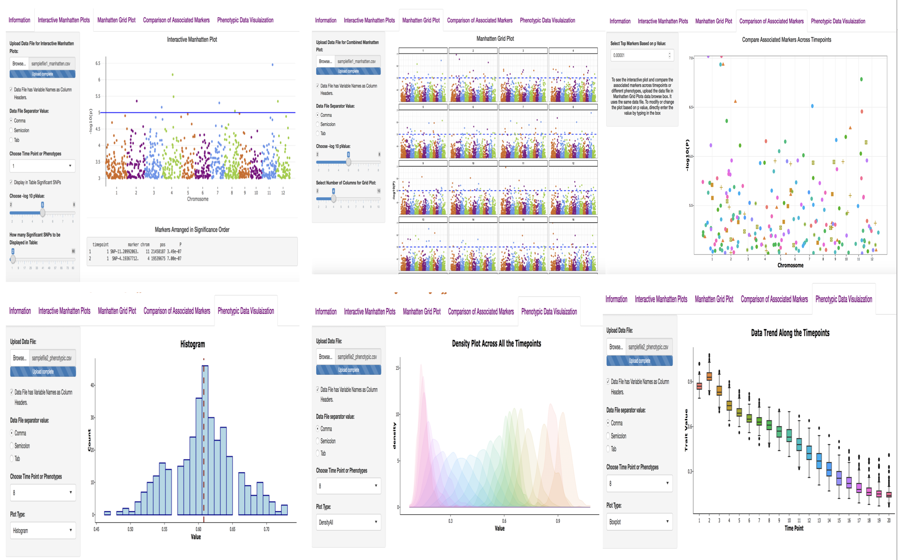

 # ShinyAIM


## Enhanced Features (v2.0)

ShinyAIM now includes comprehensive enhancements for GWAS data visualization and analysis:

### New Analysis Features
- **QQ Plots**: Assess p-value distribution with genomic inflation factor (λ) calculation
- **Multiple Testing Corrections**: Bonferroni and FDR (Benjamini-Hochberg) methods
- **Summary Statistics Dashboard**: Real-time display of key metrics (total markers, significant hits, λ, thresholds)

### Advanced Visualization
- **Custom Color Schemes**: Choose from default, colorblind-friendly, grayscale, or custom palettes
- **High-Resolution Export**: Download plots in PNG, PDF, and SVG formats
- **Interactive Data Tables**: Searchable and sortable tables using DT package
- **Loading Indicators**: Visual feedback for long-running operations

### Data Management
- **Session Save/Load**: Save analysis state and reload later (RDS format)
- **Data Preprocessing**: Filter by MAF, missing rate, and p-value thresholds
- **Multiple File Comparison**: Compare two GWAS runs side-by-side

### User Experience
- **Modern UI**: Enhanced interface with bslib theme
- **Progress Spinners**: Visual feedback for data processing
- **Improved Layout**: Better spacing, cards, and responsive design

## Installation and Usage

The application is hosted on Shinyapps.io here: https://chikudaisei.shinyapps.io/shinyaim/

The application can be run locally with just one command in R software or RStudio:</p>
```
shiny::runGitHub("ShinyAIM", "whussain2")
```
After running the above code the required libraries including 'shiny', 'ggplot2', 'dplyr', 'grid', 
'plotly', 'manhattanly', 'forcats', 'DT', 'shinycssloaders', 'bslib', 'colourpicker', 
'shinyWidgets', 'ggrepel', 'scales', and 'viridis' will be automatically installed.

These packages can also be installed by running the following code in R or RStudio:
```
install.packages(c("shiny","ggplot2","dplyr","grid","plotly","manhattanly","forcats",
                   "DT","shinycssloaders","bslib","colourpicker","shinyWidgets",
                   "ggrepel","scales","viridis"))
```

## Key Features

### Interactive Manhattan Plots
- Upload GWAS results and visualize p-values across the genome
- Customize significance thresholds
- Choose color schemes for better visualization
- Apply multiple testing corrections
- Export high-resolution figures

### QQ Plots
- Assess whether observed p-values follow expected distribution
- Calculate and display genomic inflation factor (λ)
- Detect population stratification
- Export plots for publications

### Manhattan Grid Plots
- View multiple timepoints or phenotypes simultaneously
- Adjust grid layout and visualization parameters
- Preprocess data with filtering options
- Export composite figures

### Comparison Tools
- Compare associated markers across timepoints
- Side-by-side comparison of two GWAS runs
- Interactive selection of significance thresholds

### Phenotypic Data Visualization
- Histogram and density plots
- Boxplots across timepoints
- Interactive exploration of trait distributions

### Data Management
- Save complete analysis sessions
- Load previous sessions to continue work
- Compare multiple GWAS datasets
- Session information display

# Licensing
This shiny code is licensed under Artistic License 2.0. at https://opensource.org/licenses/Artistic-2.0 .     
Copyright (c) 2018, Waseem Hussain,  code licensed under Artistic License 2.0.
# Contact
You may contact the author of this code, Waseem Hussain at <waseem.hussain@ul.edu>; <waseemhussain907@gmail.com>
# DOI
[](https://doi.org/10.5281/zenodo.1422835)

# Manuscript details
The manuscript describing the application is published in Plant Direct Jouranl and can be found here https://doi.org/10.1002/pld3.91
